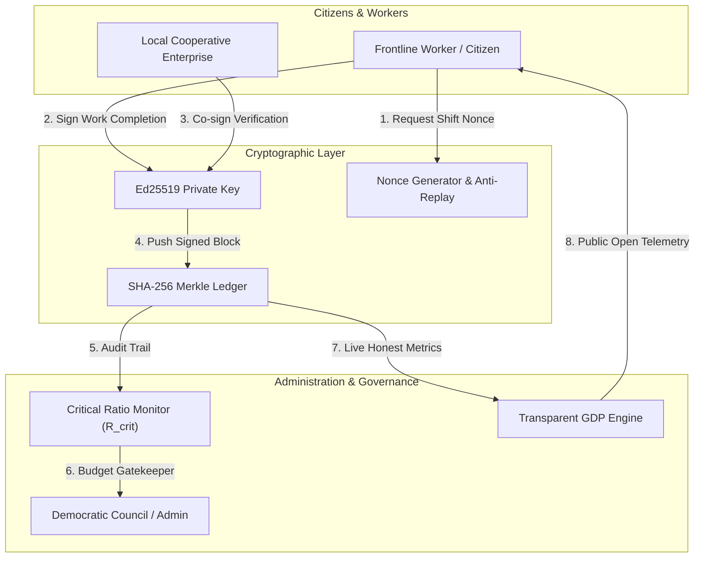

# Progressive Socialist Administration System (PSAS)

<div align="center">

[](https://opensource.org/licenses/MIT)
[](https://ed25519.cr.yp.to/)
[](#core-architecture)
[](#)

<br/>

**A Decentralized, Cryptographically Auditable Public Welfare, Democratic Labor Accounting & Transparent Economic Governance Engine.**

*Eliminating Bureaucratic Corruption, Forged Statistics, and Totalitarian Centralization through Verifiable Cryptographic Proofs.*

</div>

---

## 🏛️ Executive Summary & Philosophical Manifesto

The **Progressive Socialist Administration System (PSAS)** is an innovative socio-economic operating protocol that replaces bureaucratic opacity and top-down authoritarian state machinery with **mathematically verified, open-ledger democratic governance**.

Historically, centralized command systems collapsed into totalitarian bureaucracy where officials fabricated industrial output numbers, suppressed dissent, and enriched party elites while ordinary workers suffered. Conversely, unregulated speculative market systems generate severe wealth concentration, systemic financial manipulation, and artificial scarcity.

**PSAS establishes a third paradigm: Democratic, Technologically Enforced Democratic Socialism.**
- **No Dictatorship of the Party:** Zero-trust architecture where administrators do not possess arbitrary authority; every budget allocation, civic project, and hour of labor is cryptographically signed and peer-verified by workers.
- **Unaltered, Honest Economic Metrics:** Real Gross Domestic Product (GDP) and Real GDP per Capita are computed strictly from verified physical goods, essential services, and ecological sustainability—immunized against statistical manipulation.
- **The Critical Ratio ($\mathcal{R}_{crit}$):** An automated algorithmic sentinel that caps bureaucratic overhead and guarantees that administrative expenditure cannot outstrip direct public welfare delivery.

---

## ⚙️ Core Technical Innovations

### 1. Blockchain-Secured Government Work Verification
Traditional government work reporting suffers from "ghost workers," unverified contractor claims, and phantom development projects. PSAS introduces cryptographic shift proofs:
- **Ed25519 Dual-Key Signoff:** To record completed infrastructure or municipal work, both the frontline worker and the local democratic enterprise sign a structured payload containing GPS telemetry, timestamped task descriptions, and cryptographic nonces.
- **Anti-Replay Nonce Verification:** Every work shift requests a single-use cryptographic nonce (`POST /api/labour/start`). The terminal signoff must match the hashed nonce chain, mathematically preventing replay attacks or retroactively inflated records.
- **Immutable Merkle Hash-Chain:** Work credits are recorded into an append-only ledger where each block anchors to the previous block's SHA-256 digest. Tampering with any historical record invalidates the entire chain across the network.

### 2. The Unaltered "Critical Ratio" ($\mathcal{R}_{crit}$)
PSAS enforces an uncheatable economic efficiency metric called the **Critical Ratio**:

$$\mathcal{R}_{crit} = \frac{\sum \text{Verified Direct Productive \& Public Welfare Output}}{\sum \text{Administrative, Managerial \& Bureaucratic Overhead}}$$

- **Dynamic Budget Throttling:** If administrative bloat pushes $\mathcal{R}_{crit}$ below statutory equilibrium (e.g., $3.5:1$), the smart ledger automatically locks discretionary managerial stipends and freezes new administrative hires until frontline welfare delivery balances out.
- **Anti-Divergence Ledger:** Public budgets cannot be quietly redirected. Every civic dollar/credit is earmarked with a cryptographic destination hash verifiable by any citizen via the public dashboard.

### 3. Truth-In-Numbers: Real Transparent GDP & GDP per Capita
National statistics bureaus often inflate GDP figures through financial speculation, paper debt loops, and hedonic quality adjustments. PSAS calculates **Real Net Human Welfare Output (RNHWO)**:

$$\text{Real Transparent GDP} = \sum_{k \in \text{Essentials}} (\mathcal{Q}_k \times \mathcal{L}_k) + \sum \text{Public Services (Health, Edu, Infra)} - \mathcal{E}_{\text{ecological}}$$

- **Real GDP Per Capita:** Calculated dynamically by dividing real verifiable output by the verified active citizen registry.
- **Gini Damping Metric:** Tracks the ratio between the 90th percentile labor rewards and the 10th percentile basic dividend, programmatically preventing hyper-inequality while maintaining healthy rewards for specialized engineering, medical, and scientific labor.

---

## 🏗️ System Architecture & Workflow



---

## 🛠️ Repository Structure

```
Progressive-Socialist-Administration-System/
├── welfare-ledger/
│   ├── client/                  # React + Vite Interactive Democratic Dashboard
│   │   ├── src/
│   │   │   ├── components/      # Budget analyzers, shift verifiers, telemetry graphs
│   │   │   ├── pages/           # Worker Portal, Citizen Audit, Council View
│   │   │   └── App.jsx
│   │   ├── package.json
│   │   └── vite.config.js
│   └── server/                  # Node.js + Express Cryptographic API Engine
│       ├── src/
│       │   ├── routes/          # Auth, Labour, Admin, Enterprise, Audit routes
│       │   ├── models/          # MongoDB schemas for immutable ledgers
│       │   ├── crypto/          # Ed25519 signatures, Merkle hash-chaining, nonces
│       │   └── index.js
│       └── package.json
├── LICENSE                      # MIT Open Source License
└── README.md                    # Technical specification & Manifesto
```

---

## 🚀 Quick Start & Deployment

### Prerequisites
- Node.js >= 18.0.0
- MongoDB (Local instance or MongoDB Atlas)
- npm or yarn

### 1. Cryptographic Backend Setup
```bash
cd welfare-ledger/server
npm install
```

Configure your environment variables (`.env`):
```env
PORT=3001
MONGODB_URI=mongodb://localhost:27017/psas-ledger
JWT_SECRET=super-secure-cryptographic-salt-change-in-production
SYSTEM_MIN_CRITICAL_RATIO=3.5
NODE_ENV=development
```

Start the verification server:
```bash
npm run dev
# Server listening on http://localhost:3001
```

### 2. Frontend Citizen Dashboard
```bash
cd ../client
npm install
npm run dev
# Citizen dashboard running on http://localhost:5173
```

---

## 🔒 Cryptographic API Specification

| Route | Method | Description | Security Verification |
|---|---|---|---|
| `/api/auth/register-key` | `POST` | Registers public key certificate | Ed25519 verification |
| `/api/labour/start` | `POST` | Initiates verified civic task | Generates time-bounded cryptographic nonce |
| `/api/labour/end` | `POST` | Completes and records work credit | Verifies worker signature + enterprise counter-signature |
| `/api/admin/budgets` | `GET/POST` | Dynamic budget proposals | Gated by current Critical Ratio ($\mathcal{R}_{crit}$) |
| `/api/metrics/real-gdp`| `GET` | Public honest GDP & GDP/capita | Computed directly from immutable ledger proofs |
| `/api/ledger/audit` | `GET` | Full Merkle integrity check | Verifies root hash and block continuity |

---

## 🛡️ Security, Privacy & Anti-Totalitarian Safeguards

1. **Decentralized Key Custody:** Worker credentials and identity keys remain in local storage or hardware tokens; no central authority possesses master signing keys.
2. **Selective Zero-Knowledge Disclosures:** Citizens can prove entitlement to public goods and housing dividends without revealing their full work history or private medical data.
3. **Open-Source Auditability:** Every formula governing critical ratios, inflation dampeners, and allocation algorithms is completely open source under the MIT License.

---

## 👨‍💻 Author & Research Inquiries

Developed and researched by **[Ankit Gupta](https://github.com/researcherankit)**  
*Dual Degree in Computer Science: Hooghly Engineering & Technology College & IIT Madras.*  
Specializing in Quantitative Systems, High-Performance Systems Architecture, and Cryptographic Governance.

---

<div align="center">
<sub>Built with mathematical integrity and cryptographic transparency. Open to contributions from researchers in decentralized economics, mechanism design, and public goods finance.</sub>
</div>
